

  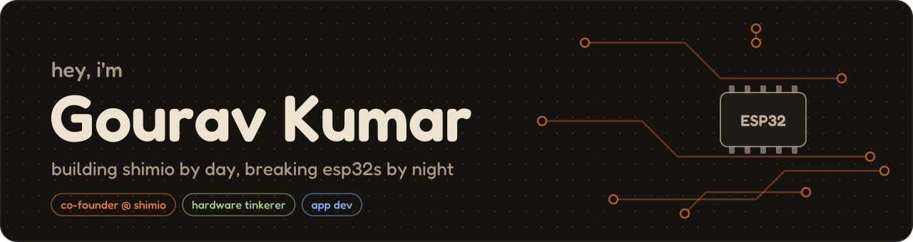

Hey, I'm Gourav. I co-founded [Shimio](https://shimio.in) and write pretty much all of its code. The rest of the time I'm soldering something to an ESP32 and then writing an app to talk to it.

  <a href="https://shimio.in">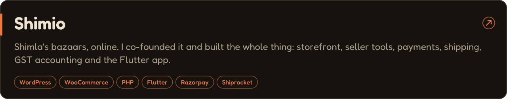</a>

  <a href="https://github.com/Joyboycoffee/Esp-Widget">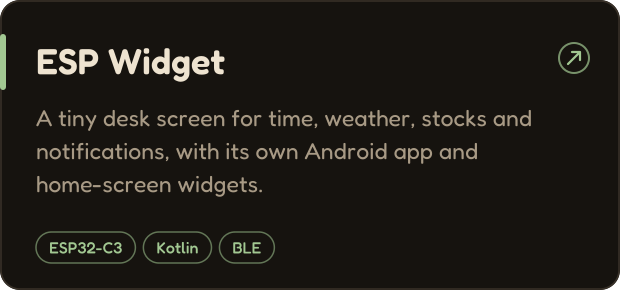</a>
  <a href="https://github.com/Joyboycoffee/Keychain">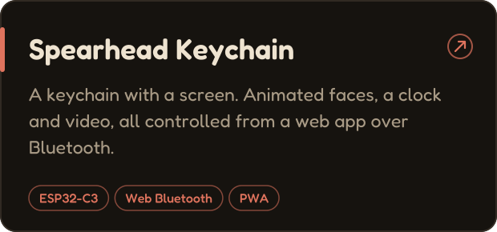</a>

  <a href="https://github.com/Joyboycoffee/SignalRGB">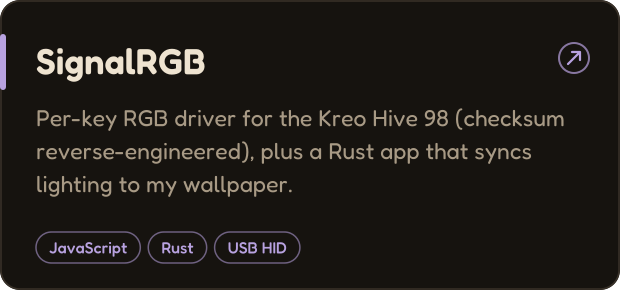</a>
  <a href="https://github.com/Joyboycoffee/Retro-Go-ESP32-S3">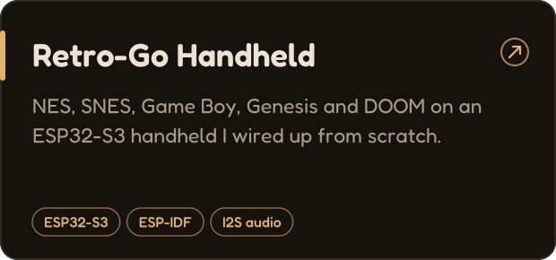</a>

  <a href="https://github.com/Joyboycoffee/ESP32-C3-Video-Streamer">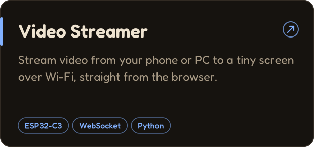</a>
  <a href="https://github.com/Joyboycoffee/ESP32-BLE-WiFi-Remote">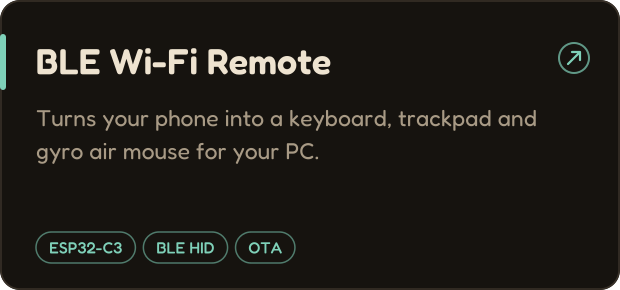</a>

  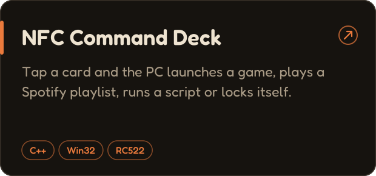
  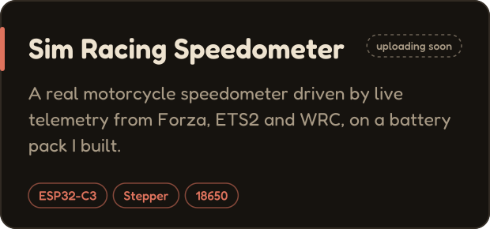

  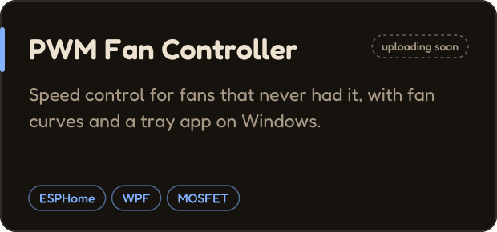
  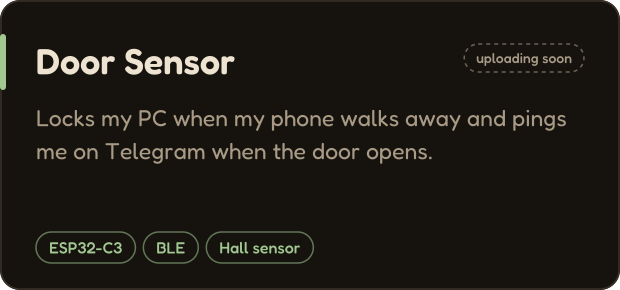

  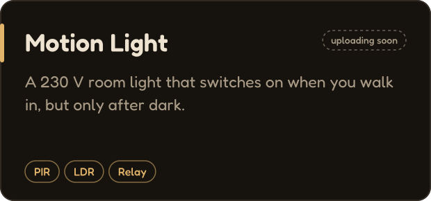
  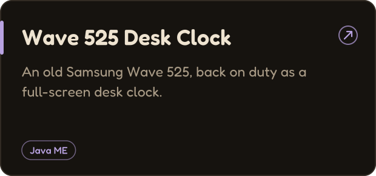

  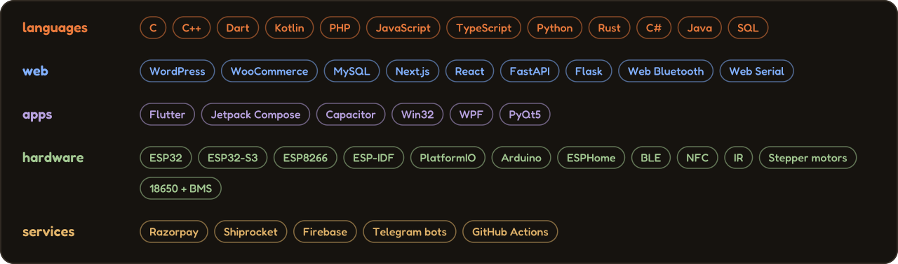

  
  
  
  

More links

[LinkedIn](https://www.linkedin.com/in/gouravkmrsroye/)

