<picture><source media="(prefers-color-scheme: dark)" srcset="assets/hero-dark.svg"></picture>

<picture><source media="(prefers-color-scheme: dark)" srcset="assets/label-now-dark.svg"></picture>
<a href="https://shimio.in"><picture><source media="(prefers-color-scheme: dark)" srcset="assets/row-shimio-dark.svg"></picture></a>
<picture><source media="(prefers-color-scheme: dark)" srcset="assets/rule-dark.svg"></picture>

<picture><source media="(prefers-color-scheme: dark)" srcset="assets/label-made-dark.svg"></picture>
<a href="https://github.com/Joyboycoffee/Esp-Widget"><picture><source media="(prefers-color-scheme: dark)" srcset="assets/row-esp-widget-dark.svg"></picture></a>
<a href="https://github.com/Joyboycoffee/Keychain"><picture><source media="(prefers-color-scheme: dark)" srcset="assets/row-keychain-dark.svg"></picture></a>
<a href="https://github.com/Joyboycoffee/SignalRGB"><picture><source media="(prefers-color-scheme: dark)" srcset="assets/row-signalrgb-dark.svg"></picture></a>
<a href="https://github.com/Joyboycoffee/NFC-Command-Deck"><picture><source media="(prefers-color-scheme: dark)" srcset="assets/row-nfc-dark.svg"></picture></a>
<a href="https://github.com/Joyboycoffee/Retro-Go-ESP32-S3"><picture><source media="(prefers-color-scheme: dark)" srcset="assets/row-retro-go-dark.svg"></picture></a>
<a href="https://github.com/Joyboycoffee/Sim-Racing-Speedometer"><picture><source media="(prefers-color-scheme: dark)" srcset="assets/row-speedo-dark.svg"></picture></a>
<a href="https://github.com/Joyboycoffee/ESP32-C3-Video-Streamer"><picture><source media="(prefers-color-scheme: dark)" srcset="assets/row-streamer-dark.svg"></picture></a>
<a href="https://github.com/Joyboycoffee/ESP32-BLE-WiFi-Remote"><picture><source media="(prefers-color-scheme: dark)" srcset="assets/row-remote-dark.svg"></picture></a>
<a href="https://github.com/Joyboycoffee/Door-Sensor"><picture><source media="(prefers-color-scheme: dark)" srcset="assets/row-door-dark.svg"></picture></a>
<a href="https://github.com/Joyboycoffee/ESP-Home-PWM-Fans"><picture><source media="(prefers-color-scheme: dark)" srcset="assets/row-fans-dark.svg"></picture></a>
<a href="https://github.com/Joyboycoffee/ESP32-Motion-Light"><picture><source media="(prefers-color-scheme: dark)" srcset="assets/row-motion-dark.svg"></picture></a>
<a href="https://github.com/Joyboycoffee/ESP32-C3-Gamepad-Bridge"><picture><source media="(prefers-color-scheme: dark)" srcset="assets/row-gamepad-dark.svg"></picture></a>
<a href="https://github.com/Joyboycoffee/Fan-RPM-Battery-Logger"><picture><source media="(prefers-color-scheme: dark)" srcset="assets/row-fanlog-dark.svg"></picture></a>
<a href="https://github.com/Joyboycoffee/Desk-clock-for-Wave-525"><picture><source media="(prefers-color-scheme: dark)" srcset="assets/row-wave-clock-dark.svg"></picture></a>
<picture><source media="(prefers-color-scheme: dark)" srcset="assets/rule-dark.svg"></picture>

<picture><source media="(prefers-color-scheme: dark)" srcset="assets/label-hi-dark.svg"></picture>

<a href="https://instagram.com/go.ur.av"><picture><source media="(prefers-color-scheme: dark)" srcset="assets/link-instagram-dark.svg"></picture></a>&nbsp;&nbsp;&nbsp;<a href="mailto:g.k.sroye@gmail.com"><picture><source media="(prefers-color-scheme: dark)" srcset="assets/link-email-dark.svg"></picture></a>&nbsp;&nbsp;&nbsp;<a href="https://shimio.in"><picture><source media="(prefers-color-scheme: dark)" srcset="assets/link-shimio-dark.svg"></picture></a>&nbsp;&nbsp;&nbsp;<a href="https://buymeacoffee.com/go.ur.av"><picture><source media="(prefers-color-scheme: dark)" srcset="assets/link-coffee-dark.svg"></picture></a>

More links

[LinkedIn](https://www.linkedin.com/in/gouravkmrsroye/)

